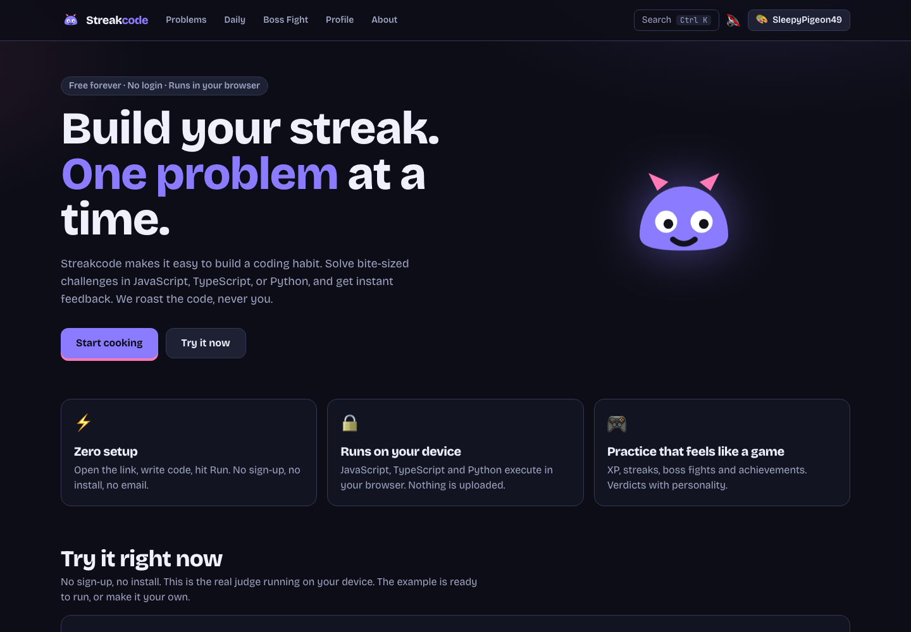
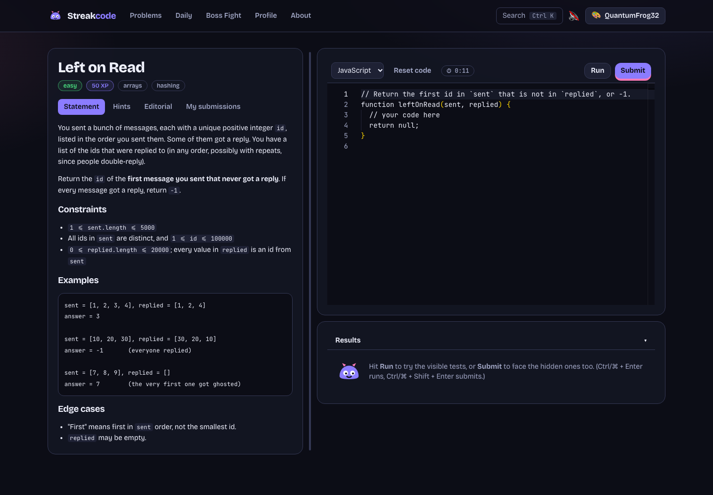
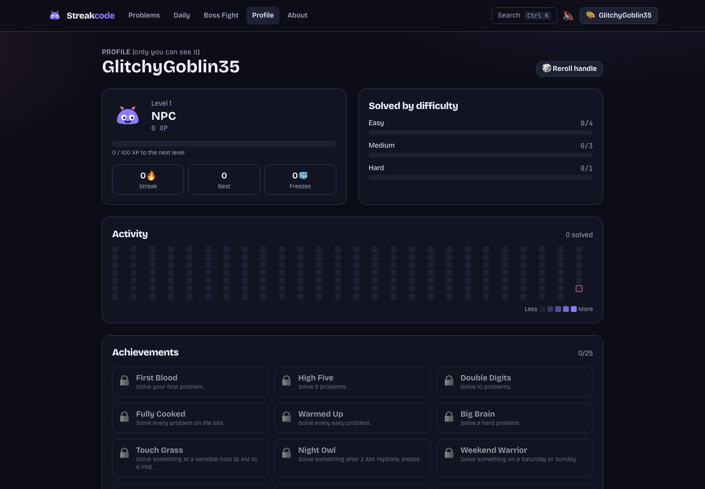
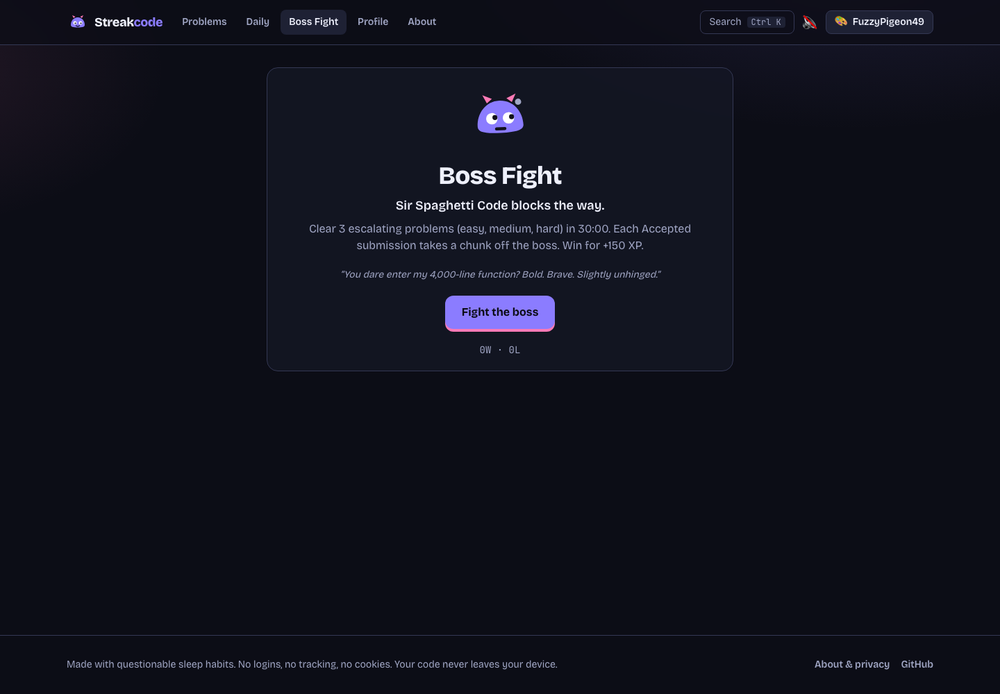

# Streakcode

> **Build your streak.** Small coding wins, one day at a time.

Streakcode is a free place to practice coding without the pressure. Pick a challenge, write your answer, and get clear feedback right away. Build a streak, collect a few wins, and come back when you feel like it.

**No account. No setup. No cost.** Your code and progress stay in your browser.

[Visit Streakcode on GitHub](https://github.com/bonsakel/streakcode)

## Take a look

| Meet Streakcode                                    | Try a challenge                                                          |
| -------------------------------------------------- | ------------------------------------------------------------------------ |
|  |  |

| Keep your progress                                             | Take on the boss                                    |
| -------------------------------------------------------------- | --------------------------------------------------- |
|  |  |

## How to use Streakcode

1. **Open a challenge.** Choose one that looks fun. They range from quick warm-ups to trickier puzzles.
2. **Choose a language.** JavaScript, TypeScript, and Python are ready to use.
3. **Write your answer.** The editor starts you off with a helpful outline. You can change it whenever you like.
4. **Press Run.** Check your answer against the examples. If something is off, the results help you see what happened.
5. **Press Submit when you're ready.** This checks all the tests and records your progress when you get it right.
6. **Come back tomorrow.** Try the Daily Challenge to keep your streak going. Your profile shows your wins, points, and achievements.

Want an extra challenge? **Boss Fight** puts three puzzles and a timer between you and a very dramatic blob. On a solved challenge, **Share result** makes a picture you can download or share.

## A few nice things

- **A little momentum:** points, levels, daily streaks, and achievements make practice feel rewarding.
- **Your pace, your look:** pick a theme and choose how playful the feedback should be.
- **A quick way around:** press **Ctrl+K** (or **⌘K** on Mac) to find a challenge or change a setting.
- **Your progress belongs to you:** export a backup from your profile, or import it on another device.

## Privacy, plainly

Streakcode does not ask for your name or email, and it does not track you. Your answers run on your own device; they are not sent to us. Your progress is saved in this browser, and you can export it or clear it whenever you want.

## Want to run it on your computer?

You only need Node.js and npm:

```sh
git clone https://github.com/bonsakel/streakcode.git
cd streakcode
npm install
npm run dev
```

The local address will appear in the terminal. Open it in your browser and start practicing.

To check your changes before sharing them:

```sh
npm run lint
npm run typecheck
npm test
npm run build
```

## Made with care

Streakcode is open source under the [MIT License](LICENSE). The illustrations and mascot are original to the project. The editor, fonts, and Python runtime are included with the app rather than loaded from advertising or tracking services.

If Streakcode helped you get one more practice session in, that is a win worth celebrating. ⭐
